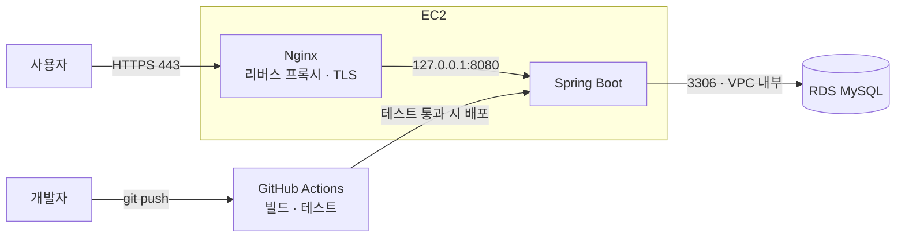

# 회원, 상품, 주문 REST API 서버
회원가입부터 상품 검색, 주문까지 처리하는 쇼핑몰 백엔드 API 서버입니다.
동시 주문 환경에서 재고 정합성을 지키는 데 중점을 두고, 문제를 테스트로 재현하고 검증하며 개선했습니다.

- 배포 주소: https://hongjpa.duckdns.org
- API 명세 · 테스트: https://hongjpa.duckdns.org/swagger-ui.html

## 기술 스택

Java 17, Spring Boot, Spring Data JPA, Querydsl, MySQL, Docker Compose, JUnit5, MockMvc, BCrypt, Swagger(springdoc-openapi),
AWS EC2, AWS RDS(MySQL), Nginx, Let's Encrypt, GitHub Actions

## 핵심 문제 해결

- [주문 트랜잭션 개선: 재고 불일치와 커넥션 풀 고갈 해결](docs/order-transaction.md)
- [데드락 해결: 원인 분석과 Lock 획득 순서 고정](docs/dead-lock.md)
- [AWS 배포: 구조 설계와 트러블슈팅](docs/deployment.md)

## 배포 구조



- **HTTPS**: Nginx에서 TLS를 처리하고 Let's Encrypt 인증서를 자동 갱신, HTTP 요청은 HTTPS로 리다이렉트
- **외부 공개 포트 최소화**: 80/443만 공개하고, Spring은 127.0.0.1에서만 요청을 받아 외부에서 직접 접근 불가
- **DB 네트워크 격리**: RDS는 퍼블릭 액세스를 끄고, EC2 보안 그룹에서 오는 요청만 허용
- **환경별 설정 분리**: local / prod 프로필 분리, 운영 DB 정보는 서버 환경변수로 주입
- **CI/CD**: push마다 MySQL 컨테이너에서 테스트를 실행하고, 실패하면 배포 중단
- **배포 시 SSH 최소 개방**: 러너 IP만 배포 중에 임시로 허용하고 종료 후 회수
- **최소 권한**: 배포용 IAM 사용자는 해당 보안 그룹의 규칙 추가·삭제만 가능
- **한계**: 단일 인스턴스이고, 배포 시 `systemctl restart`로 수십 초간 서비스가 중단됨

## 로컬 실행 방법

local 프로필로 실행됩니다. (운영 서버는 prod 프로필로 실행)

MySQL 컨테이너를 먼저 실행합니다.

```bash
docker compose up -d
```

애플리케이션을 실행합니다.

```bash
./gradlew bootRun
```

- 로컬 주소: http://localhost:8080
- `ddl-auto: create` 설정으로 실행할 때마다 테이블과 데이터가 초기화됩니다.
- 초기 데이터는 `InitDb` 클래스에서 생성되며, local 프로필에서만 동작합니다.
- 로그인 세션이 없으면 기본 ADMIN 계정 세션이 자동 적용됩니다. (local 전용)

## 테스트

MySQL 컨테이너가 실행 중이어야 합니다.

```bash
./gradlew test
```

GitHub Actions에서는 MySQL 서비스 컨테이너를 띄워 push마다 같은 테스트를 실행합니다.

## API 명세

Swagger에서 전체 API를 확인하고 직접 호출해 볼 수 있습니다.
https://hongjpa.duckdns.org/swagger-ui.html

- 응답 형식: `ApiResponse` 클래스로 통일
- 예외 처리: `CustomStatusException` → `GlobalExceptionHandler`에서 관리
- 인증: 세션 방식. `/api/login`으로 로그인하면 같은 브라우저에서 로그인 상태가 유지됩니다


## 변경 이력

2026/7/1 첫 업로드

2026/7/2 로그인 기능,관리자 권한 체크,멤버 삭제,ApiResponse 형식 추가

2026/7/5 카테고리 생성,상품 생성,상품생성시 중복체크,필수 입력항목 체크 추가

2026/7/9 모든 상품 정보 조회,주문생성,모든주문조회 추가

2026/7/10 특정멤버 주문조회 추가

2026/7/13 상품 검색 추가

2026/7/16 코드 수정으로인한 side effect의 확인을 용이하게 하기위해 MockMvc를 활용한 회원가입, 로그인, 주문 API 테스트 코드 작성.
동시에 주문시 재고부족문제+그로인한 주문 동시생성 방지를 위해 Lock 적용(비관적/낙관적 Lock 검토 후 비관적 Lock 적용).

2026/8/17 실행시 기본 local 프로필로 실행되도록 변경, 별도의 H2 데이터베이스 서버 실행 없이 Spring Boot 실행만으로 데이터베이스가 생성됩니다.(10/31 MySQL로 변경되어 현재는 해당 없음)
남아있던 기존 실습의 화면 관련 코드 및 Thymeleaf 의존성 삭제.

2026/10/30 비밀번호 BCrypt 해시 저장으로 변경
- 기존: 비밀번호를 평문으로 저장하고 equals로 비교
- 변경: 가입 시 BCryptPasswordEncoder로 암호화 해 저장, 로그인 시 matches()로 검증

주문 트랜잭션 통합(REQUIRES_NEW 제거), 락 순서 고정, 동시성·롤백 테스트 추가
- 참고: OptimisticItemLock은 현재 비활성(단일 트랜잭션 구조와 맞지 않음)
- 상세: [주문 트랜잭션 개선 과정](docs/order-transaction.md)

2026/10/31
- H2 데이터 베이스를 MySQL로 변경적용.
- 서로 다른 사람이 상품을 교차순서로 동시주문할 시 발생할수 있는 데드락 문제 해결. 
- 상세: [데드락 해결과정](docs/dead-lock.md)
- Item 엔티티의 name 컬럼에 인덱스 추가(주문 시 상품 이름 조회의 풀스캔 개선).

2026/11/1
- Lock 대기시간 설정을 'innodb_lock_wait_timeout'으로 변경.
- 주문 상품 정렬 기준에 카테고리를 추가해 이름이 같은 상품의 Lock 순서도 고정.

2026/11/05
- prod 프로필 분리: DB 접속 정보 환경변수화, ddl-auto 환경별 설정
- AWS EC2·RDS 배포, systemd 서비스 등록
- InitDb(초기 데이터)를 local 프로필로 제한: 배포 후 점검 중 운영 DB에 기본 관리자 계정이 생성되는 문제를 발견해 수정

2026/11/06
- GitHub Actions CI/CD 구성: push 시 빌드·테스트 후 EC2 자동 배포
- CI에서 MySQL 컨테이너로 테스트 실행, 테스트 실패 시 배포 중단 확인

2026/11/07
- DuckDNS 도메인, Nginx 리버스 프록시, Let's Encrypt HTTPS 적용 (인증서 자동 갱신)
- 보안 그룹에서 8080 직접 접근 차단, Spring은 127.0.0.1에서만 요청을 받도록 설정
- Swagger(springdoc-openapi) 적용, 홈 화면에 API 사용 안내 추가
- README·docs 등 문서만 바뀐 경우 배포가 실행되지 않도록 워크플로 수정

2026/11/08
- 비로그인 응답 401 형식으로 통일

2026/11/09
- 상품검색 페이징 중복 수정 및 테스트 추가
- 페이징을 page, size만 파라미터로 받게 변경 및 검증추가, 페이징 시 기본정렬추가
