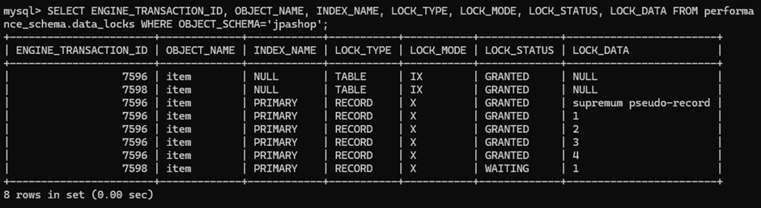
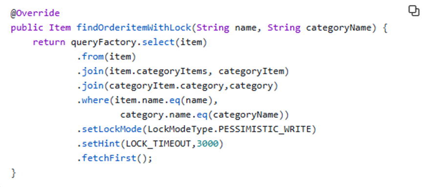
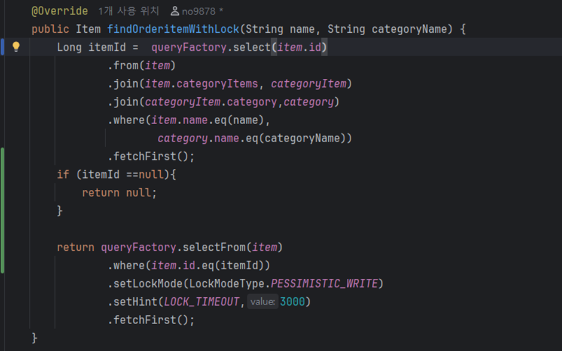
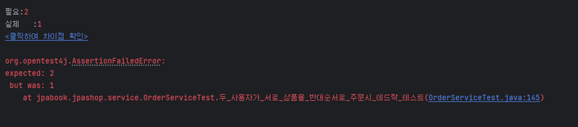
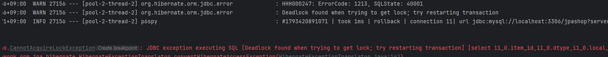
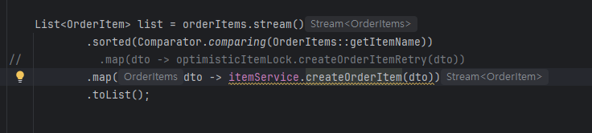
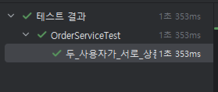

# 데드락 해결: 원인 분석과 Lock 획득 순서 고정

## 문제

고객 A가 상품1 → 상품2, 고객 B가 상품2 → 상품1 순서로 동시에 주문하면, A는 상품1의 락을 잡고 상품2를 기다리고 B는 상품2의 락을 잡고 상품1을 기다리는 교차 대기로 데드락이 발생할 수 있음.

## 데드락이 재현되지 않음

기존 락 순서 정렬의 효과를 검증하기 위해 정렬 코드를 주석 처리하고, 락 대기가 겹치도록 재고 차감 전 `Thread.sleep(100)`을 임시로 추가한 뒤 테스트를 실행함.

실행 결과 테스트가 통과됨(데드락이 발생하지 않음).

## 원인 분석

- **확인**: `performance_schema.data_locks`를 확인한 결과, 상품 하나를 조회해도 모든 상품 행에 락이 걸리고 다른 트랜잭션은 대기함
- **원인**: `item.name`에 인덱스가 없어 풀스캔이 발생하고, 조회 과정에서 읽은 행까지 락이 걸림. 결과적으로 주문이 한 건씩 순서대로 처리되어 데드락이 발생하지 않고 테스트가 통과함

## 해결 1: 대상 행에만 락이 걸리도록 쿼리 분리

락 없이 상품 id를 먼저 조회한 뒤, PK로 해당 상품 행에만 락을 걸도록 쿼리를 분리함.

기존

변경

다시 테스트 실행

- **결과**: 주문 성공이 1건으로 테스트 실패. 콘솔에서 `Deadlock found when trying to get lock` 예외 확인. MySQL이 데드락을 감지해 한쪽 트랜잭션을 롤백하고 나머지만 커밋함 → **데드락 재현 성공**

## 해결 2: 락 획득 순서 정렬

상품 이름순으로 락 획득 순서를 정렬함.

테스트 실행

- **검증**: 테스트 성공. 재현용 `Thread.sleep` 제거 후 `OrderServiceTest` 전체 3개 테스트 통과 확인

## 이후 개선

데드락 해결과 별개로, 주문 시 상품 이름 조회의 풀스캔을 개선하기 위해 `name` 컬럼에 인덱스를 추가함.