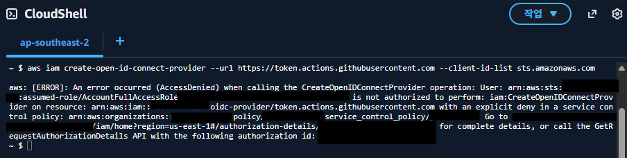
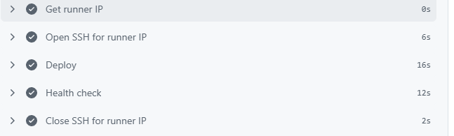
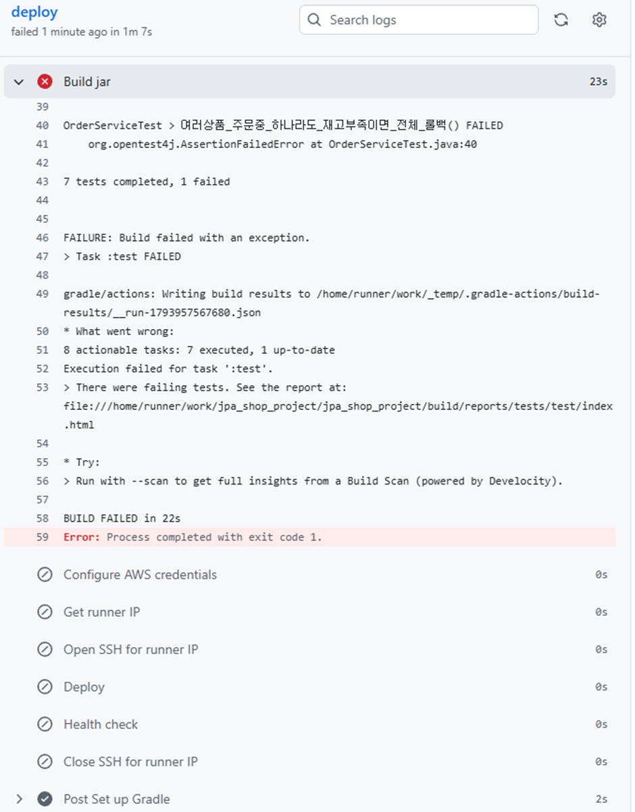

# AWS 배포: 구조 설계와 트러블슈팅

## 1. 배포 구조

README의 [배포 구조](../README.md#배포-구조) 참고.

## 2. 설계 결정

| 결정 | 이유 |
|---|---|
| RDS 퍼블릭 액세스 차단, 인바운드 소스를 EC2 보안 그룹 ID로 지정 | DB를 인터넷에 노출하지 않고, EC2 IP가 바뀌거나 서버가 늘어나도 설정 변경 불필요. 로컬 PC에서는 접속되지 않고 EC2에서만 접속되는 것을 확인 |
| EC2와 RDS를 같은 가용 영역에 배치 | 지연 시간과 AZ 간 데이터 전송 비용 절감 |
| local / prod 프로필 분리, 운영 DB 정보는 서버 환경변수 파일(권한 600)로 주입 | 비밀값을 코드와 저장소에서 분리 |
| systemd 서비스로 실행 | SSH 세션과 무관하게 실행, 부팅 시 자동 시작, 장애 시 자동 재시작 |
| Nginx 리버스 프록시 + Let's Encrypt | TLS 처리와 인증서 자동 갱신을 애플리케이션과 분리, 외부 공개 포트는 80/443만 |
| Spring은 127.0.0.1에서만 요청 수신 | 보안 그룹이 실수로 열려도 외부에서 직접 접근 불가 (다층 방어) |
| AWS 무료 플랜 사용, 시드니 리전 | 비용 0원 유지. 무료 플랜은 리전 1곳으로 제한됨 |

## 3. 트러블슈팅

### 3-1. prod 실행 시 `Unable to determine Dialect without JDBC metadata`

- **문제**: EC2에서 prod 프로필로 실행하면 애플리케이션이 시작되지 않음
- **분석**: 이 오류는 DB 연결 실패의 결과라고 판단. 로그에서 처음 발생한 WARN(`Could not obtain connection`)을 찾고 그 아래 원인을 추적
- **원인**: `DB_URL` 환경변수에 `jdbc:mysql://` 접두사가 빠져 있어 MySQL 드라이버가 URL을 거부
- **해결**: 올바른 JDBC URL 형식으로 환경변수 재설정
- **배운 점**: 연쇄적으로 발생한 오류는 마지막이 아닌 **처음 발생한 오류**를 봐야 한다. 환경변수 오타는 컴파일 단계에서 걸러지지 않는다

### 3-2. 운영 DB에 기본 관리자 계정이 생성되는 문제

- **문제**: 배포 후 외부 노출 범위를 점검하던 중, 테스트 데이터 초기화 코드(`InitDb`)에 프로필 제한이 없는 것을 발견. 운영 DB에 공개 저장소에 적힌 비밀번호의 관리자 계정이 생성되고, 재시작할 때마다 데이터가 중복됨
- **해결**:
    - `InitDb`에 `@Profile("local")` 적용
    - 운영 DB를 정리한 뒤 재배포
    - 운영 관리자 계정은 비밀번호가 코드에 남지 않도록 일반 가입 후 DB에서 권한만 부여
- **검증**: 해당 계정으로 로그인이 실패하는 것을 `curl`로 확인
- **배운 점**: 테스트용 코드도 운영 환경에서 실행될 수 있다. 배포 전 점검 항목(프로필 제한, 하드코딩된 비밀번호, 공개 포트)을 체크리스트로 만듦

### 3-3. GitHub Actions용 OIDC 설정 불가 → 최소 권한 키로 대체

- **문제**: GitHub Actions에서 액세스 키 없이 AWS에 인증하려고 OIDC 공급자를 만들었으나 `AccessDenied`
- **원인**: 무료 플랜 계정은 AWS가 관리하는 Organization에 속해 있고, **SCP(서비스 제어 정책)의 명시적 거부**로 `iam:CreateOpenIDConnectProvider`가 차단됨. 관리자 권한이 있어도 명시적 거부가 우선함
- **해결**:
    - 배포 전용 IAM 사용자를 만들고, **특정 보안 그룹의 인바운드 규칙 추가·삭제만** 허용하는 정책 부여
    - 키가 유출되어도 인스턴스 생성·삭제나 데이터 접근이 불가능하도록 피해 범위를 제한
    - 배포 전용 SSH 키를 따로 만들어 유출 시 그 키만 제거할 수 있게 함
- **배운 점**: 실무 환경이라면 OIDC가 더 적합하다. 제약 때문에 차선책을 쓸 때는 그 위험 범위를 이해하고 줄여야 한다

### 3-4. 배포 중 SSH 접근 문제와 해결

- **문제**: SSH(22)는 내 IP에만 열려 있어 GitHub Actions 러너가 접속할 수 없음. 러너 IP는 매번 바뀌고 수가 많아 미리 허용할 수 없음
- **해결**: 배포할 때만 러너의 현재 IP 하나(`/32`)를 허용하고, 배포가 끝나면 성공·실패와 관계없이 회수(`if: always()`)
- **검증**: 배포 후 보안 그룹에 러너 IP가 남아 있지 않은 것을 확인

### 3-5. 테스트 실패 시 배포가 막히는지 검증

- **목적**: CI가 실제로 잘못된 코드의 배포를 막는지 확인
- **방법**: 테스트를 일부러 실패하게 만들고, 홈 화면 문구를 같이 바꿔서 push
- **결과**: 빌드·테스트 단계에서 중단되고 배포 단계는 실행되지 않음. 운영 서버는 이전 문구 그대로 유지, 보안 그룹에도 변화 없음. 원래대로 되돌린 뒤 정상 배포 확인

 

### 기타

- `nslookup`으로 도메인을 확인할 때 통신사 DNS 접미사가 붙고 다른 IP가 응답됨 → 끝에 점을 붙인 전체 도메인과 공용 DNS(8.8.8.8)로 다시 확인

## 4. 한계와 개선 방향

- **무중단 배포 아님**: 재시작하는 동안 수십 초간 502 응답. 무중단 배포(Blue-Green)는 애플리케이션 두 개를 동시에 띄워야 하는데, 현재 인스턴스(t3.micro, 메모리 1GB)로는 메모리가 부족해 적용하지 않음
- **동시성 테스트의 한계**: 동시성 테스트는 비결정적이라 Lock 제거 같은 변경을 매번 잡아낸다고 보장할 수 없음
- **SSH 기반 배포**: 배포 중 22번 포트를 잠시 연다. 개선한다면 S3 + SSM으로 SSH 없이 배포해 22번 포트 노출을 없앨 수 있음
- **로그인 보호**: 로그인 시도 횟수 제한과 비밀번호 정책이 아직 없음