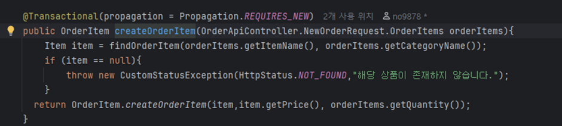
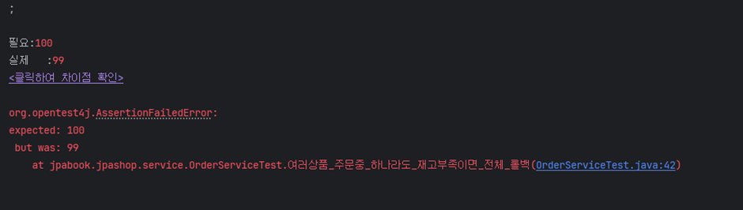
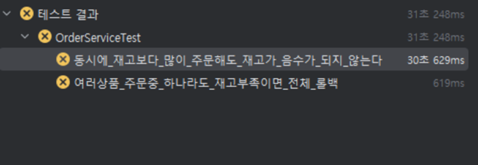
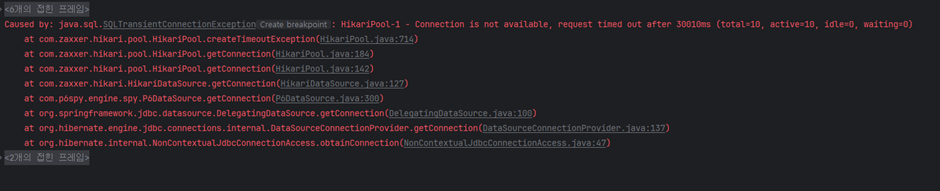
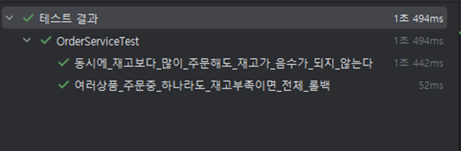

주문 트랜잭션 개선(재고 정합성)

수정 전 기존 코드 (REQUIRES_NEW를 사용)               

- 문제: 상품별 REQUIRES_NEW로 재고 차감이 먼저 커밋되어, 다중 상품 주문 중 일부가 실패하면 앞 상품의 재고만 감소한 채 남음, 동시 주문 20건 테스트에서는 처리가 멈춤(30초 타임아웃)

   

- 원인: 바깥 주문 트랜잭션이 커넥션을 쥔 채 안쪽 REQUIRES_NEW 트랜잭션이 커넥션을 하나 더 요청함.
동시 주문이 몰리면서 커넥션 풀(10개)이 고갈되어, 로그에서 커넥션 획득 타임아웃(30초)을 확인함.

- 해결: 단일 트랜잭션으로 통합, 상품 락 획득 순서를 이름순으로 고정(데드락 예방)

- 검증: 부분 실패 시 전체 롤백 테스트, 동시 주문 20건(재고 10) 테스트 -> 성공 10, 재고 부족 10, 최종 재고 0

